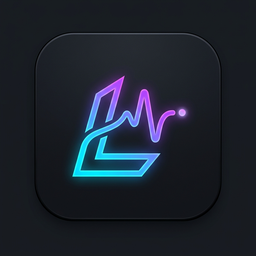

<div align="center">

  

  # Larplife

  **Ultra-lightweight, standalone Discord Rich Presence daemon written in 100% Rust.**

  [](LICENSE)
  [](https://www.rust-lang.org/)
  [-lightgrey.svg)]()
  []()

</div>

---

## Overview

When you're editing videos in CapCut, 3D modeling in Blender, designing in Photoshop, coding in VS Code, or developing custom tools, Discord often fails to detect what you're doing — or leaves your status blank without icons, active file titles, or work duration. Creating custom Discord Application IDs manually for every tool is tedious and hits account limits.

**Larplife** solves this effortlessly. It is an independent, native Windows background utility that monitors your active workspace and displays high-quality Discord Rich Presence cards in real time, with virtually zero impact on your system resources.

---

## Key Features

- **⚡ Instant 0-Second Detection:**
  Detects your active workspace the moment the app starts. Switch debounce prevents Discord rate limits while keeping updates snappy (< 1 second).

- **🛡️ 3-Layer Application ID System:**
  - **Layer 1 (Automatic Search):** Automatically matches your `.exe` against Discord's public detectable database using an intelligent 3-tier scoring algorithm, generic blacklist filtering, and a 24-hour local disk cache.
  - **Layer 2 (Zero-Quota Fallback):** No Discord Developer account? No problem. Applications work out of the box using Larplife's built-in identity, showing your custom logo and application name in the details.
  - **Layer 3 (Custom Application ID):** Power users can click a single button to copy the app name and jump straight to the Discord Developer Portal.

- **🎨 Multi-Host Image Upload & Native Icon Extraction:**
  - **Extract from `.exe`:** Automatically pulls high-resolution icons straight out of executable files with full 32-bit alpha transparency (no black background glitches) and uploads them in one click.
  - **Local Image Upload:** Pick any local `.png`, `.jpg`, or `.webp` file. Larplife automatically uploads it via a resilient multi-host service (Catbox.moe with automatic failover to 0x0.st) to provide a Discord-ready HTTPS URL.

- **🏷️ Dual-Layer Visual RPC Cards:**
  Displays a large application logo paired with a circular Larplife badge in the bottom-right corner.

- **🔒 Privacy & Title Sanitization:**
  Automatically strips sensitive folder paths (`D:\Projects\SecretClient\file.psd` becomes `file.psd`), filters customizable noise words, and provides a one-click toggle to hide window titles entirely.

- **🪶 Extreme Efficiency:**
  Runs as a pure Win32 background process consuming just **2.1 to 5.8 MB of RAM** and ~0% CPU. Zero heavy async runtimes (`tokio` is not used).

- **🖥️ Standalone Settings GUI:**
  Features a clean, non-blocking native GUI built with `egui`/`eframe`. All network tasks run on background worker threads, keeping the interface smooth at 60 FPS.

---

## Getting Started

### Prerequisites
- Windows 10 or 11 (64-bit)
- [Rust toolchain](https://rustup.rs/) (Edition 2024 / Rust 1.85+)
- Discord desktop client (Stable, PTB, or Canary)

### Building from Source

Clone the repository and build an optimized release binary:

```bash
git clone https://github.com/ArtixForLiving/larplife.git
cd larplife
cargo build --release
```

The compiled standalone executable will be located at:
```text
target/release/larplife.exe
```

---

## Usage

### 1. Launching the Background Daemon
Double-click `larplife.exe` (or run it without arguments). It starts quietly in the system tray with no terminal window:
```powershell
.\larplife.exe
```
Right-click the tray icon to:
- Pause or resume activity tracking.
- Open the Settings window.
- Toggle startup on Windows login.
- Exit the application.

### 2. Opening the Settings GUI
You can open settings via the tray menu, or directly from the terminal:
```powershell
.\larplife.exe --settings
```

From the Settings interface, you can:
- Adjust check intervals and clear timeouts.
- Add or remove applications from your tracking list.
- Select from currently running processes using the dropdown.
- Search for Discord App IDs automatically or extract icons from `.exe` files.
- Toggle the Larplife badge and customize hover text.

---

## Configuration (`config.json`)

Larplife stores its configuration alongside the executable in `config.json`. Here is an example:

```json
{
  "check_interval_seconds": 2,
  "clear_timeout_seconds": 30,
  "default_discord_app_id": "1350000000000000000",
  "badge_enabled": true,
  "badge_image_url": "https://files.catbox.moe/9dxq29.png",
  "badge_text": "larplife v0.3.0",
  "apps": [
    {
      "app_name": "Visual Studio Code",
      "process_name": "Code.exe",
      "discord_app_id": "1182391850166190130",
      "logo_key": "vscode_logo",
      "logo_text": "Visual Studio Code",
      "default_details": "Writing code",
      "state_text": "Workspace Active",
      "hide_window_title": false,
      "keep_active_in_background": false,
      "strip_title_words": [" - Visual Studio Code"]
    },
    {
      "app_name": "My Custom Project",
      "process_name": "MyProject.exe",
      "discord_app_id": "",
      "logo_key": "https://files.catbox.moe/example.png",
      "logo_text": "Custom App",
      "default_details": "Working on project",
      "state_text": "Active",
      "hide_window_title": false,
      "keep_active_in_background": false,
      "strip_title_words": []
    }
  ]
}
```

---

## Testing

Larplife includes a comprehensive suite of unit and hermetic integration tests:

```bash
cargo test
```

All 98 tests run offline without making external network calls.

---

## License

This project is licensed under the [MIT License](LICENSE).
